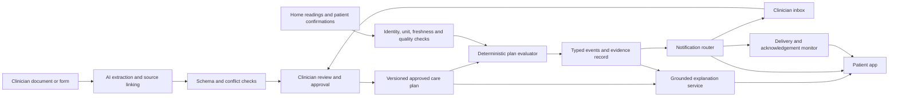

# Care Plan Bridge: product framework for critique

> **Superseded (2026-09-23):** Care Plan Bridge was dropped. The project is **aura-health**; see [`aura_health_framework_v1.0.md`](aura_health_framework_v1.0.md). Kept for background only.

**Status:** concept draft, 19 September 2026. This is a product and prototype design, not a validated clinical protocol or a claim of regulatory approval. All patient stories and thresholds used in a demo will be fictional. Decisions marked **open** need clinical, patient, or operational input.

## 1. Executive thesis

Care Plan Bridge helps a person carry out a **clinician-authored care plan at home**. It converts instructions into understandable steps, associates those steps with objective home measurements, detects gaps that can actually be observed, and sends the care team useful evidence when an approved escalation condition is met. Its distinctive value is the connection between **the patient's specific plan**, **what happened at home**, and **the next action the clinician already specified**.

The product is aimed at the hackathon brief's **“AI Healthier Every Day: Intelligent Support for Long-Term Care”** case study. The working demo focuses on an adult managing type 2 diabetes and hypertension. This is one long-term-care case study with two related monitoring streams, not an attempt to solve the separate self-triage challenge. A single-condition pilot could be chosen after clinician interviews if two streams prove too broad.

The central hypothesis is: a patient and care team can follow a plan more reliably if every instruction is understandable, every monitored observation is linked to the relevant instruction, and every alert explains its evidence and intended recipient. We will test this hypothesis; we will not presume improved health outcomes from a hackathon prototype.

**One-line pitch:** “Turn the care plan you already have into clear home steps and useful clinician feedback.”

## 2. Why this project exists

The brief asks the long-term-care solution to support medication understanding and routines, health tracking, preventive care, and preparation for healthcare visits. It asks for personalization and longitudinal response while remaining bounded: explanation must not become independent medication advice. It requires a live demo, architecture diagram, and source code. The [local brief](./AI_CAN_DO_IT_Hackathon_Singapore_2026_Brief.pdf) also requires proof of CodeBuddy or WorkBuddy use in the submission; that is a submission requirement, separate from our product architecture.

Basic tracking is crowded. [Dexcom Clarity](https://www.dexcom.com/en-us/clarity) and [Abbott Libre](https://www.freestyle.abbott/us-en/libre-living/spotting-glucose-trends.html) already show glucose patterns and reports. [Omron Connect](https://omronhealthcare.com/omron-connect-app) offers BP trends, reports, and reminders. We should not pitch another dashboard as innovation. The opportunity to investigate is whether a system can make **individual clinician instructions operational** across home measurements and turn exceptions into a concise, trusted handoff. That is a proposed differentiation, not a claim that no competitor has it.

The alert problem is real: an [observational study of remote monitoring](https://pmc.ncbi.nlm.nih.gov/articles/PMC12206671/) reported large alert volumes and examined how monitoring workflows could reduce unnecessary processing. Its findings do not establish that this product will solve alert fatigue; they justify measuring alert burden as a first-class outcome.

## 3. Users, roles, and jobs

| Role | Job to be done | Authority and limits |
|---|---|---|
| Patient | Understand today's instructions; record or sync measurements; know whether the system has enough information; see what is shared with the care team. | May confirm their own actions and correct data. Does not have to accept an AI interpretation as a clinical decision. |
| Caregiver, if invited | Help with measurements and routines while respecting the patient's sharing choices. | Scoped access granted by the patient or appropriate legal representative. Actions remain attributed to the caregiver. |
| Clinician or designated care-team member | Author and approve the executable plan; set review and contact routes; inspect evidence; change or retire the plan. | Owns clinical content and decisions. The software may draft, organize, and surface information. |
| Care-team administrator | Configure service hours, inbox ownership, backups, and technical integration. | Cannot silently change clinical thresholds or medication instructions. |
| Product operator | Maintain system reliability, security, and audit logs. | No routine access to identifiable clinical content without an approved support workflow. |

The product must name the **actual responsible team** for each alert. “Sent to clinician” is not enough: the system needs a destination, delivery result, and acknowledgement status. If no team has agreed to monitor alerts, the product must not advertise real-time clinical monitoring.

## 4. Intended use and explicit boundaries

### Intended use for the concept

- Translate a clinician-authored plan into plain-language patient steps.
- Monitor whether *observable* plan activities happened: for example, a scheduled BP measurement arrived, or a patient explicitly confirmed taking a prescribed medicine.
- Compare validated home observations with clinician-approved conditions and show the evidence used.
- Surface unclear or conflicting instructions for clinician resolution.
- Notify the care team according to an approved routing and service-hours plan.
- Prepare a concise longitudinal summary for visits.

### Outside scope

- Diagnosing a disease, predicting an emergency from a generic model, or replacing a clinician's judgement.
- Creating new medication doses, changing treatment, or telling a patient to stop or double medicine.
- Treating a physiological reading as proof that a medicine was or was not taken.
- Promising continuous clinician surveillance without a staffed service and a defined response time.
- Using a generic public guideline to override an active patient-specific plan. If the plan seems unsafe or conflicts with an external source, the system requests clinician review rather than silently changing it.
- Using lack of data as evidence that the patient is well or that they failed to comply.

Because the product monitors medical conditions and may affect care decisions, its actual regulatory status would require an intended-use assessment before real-world deployment. Singapore's [HSA software medical device guidance](https://www.hsa.gov.sg/docs/default-source/hprg-mdb/guidance-documents-for-medical-devices/gl-04-r4-regulatory-guidelines-for-software-medical-devices---a-life-cycle-approach-%282025-dec%29-pub.pdf?sfvrsn=857a2001_1) covers software intended to detect, monitor, treat, or manage medical conditions. Calling the product a “companion” does not settle classification. For the hackathon, all demonstrations use simulated records and actors.

## 5. Product principles

1. **Clinician-authored intent is primary.** AI proposes a structured interpretation; a clinician confirms it before monitoring or escalation uses it.
2. **Every active action is traceable.** Show the approved plan version, source passage, relevant observations, evaluation rule, and contact route.
3. **Observation is not inference.** “No BP uploaded” is different from “BP was not measured.” “High glucose” is different from “medicine was missed.”
4. **Uncertainty is local.** One ambiguous instruction pauses only the dependent rule. Clear, unrelated steps continue.
5. **Respond in proportion to evidence.** A measurement-quality issue prompts rechecking where the plan allows it; a sustained plan-defined condition triggers its approved action; high-priority conditions are not delayed for statistical smoothing.
6. **Alert capacity is finite.** Escalation is a configured workflow with ownership, hours, deduplication, and acknowledgement.
7. **The patient remains a participant.** The app explains what it noticed and what it shared; it does not shame the patient for missed tasks.
8. **Changes are controlled.** A new document does not silently replace an approved plan. A new plan version must be reconciled and activated.

## 6. Working patient scenario

A fictional adult has a clinician-approved plan for type 2 diabetes and hypertension. The plan includes medication instructions, a home BP schedule, a glucose measurement schedule, personalized ranges, a follow-up appointment, and explicit conditions for contacting the care team. The application can receive readings from an imported CSV or simulated connected devices. The patient can confirm an action, report a barrier, or ask what an instruction means.

This gives the demo meaningful variation:

- **Routine day:** measurements arrive on time; the app confirms the plan is being followed without generating a clinician alert.
- **Poor-quality reading:** BP arrives immediately after exercise or with a device error. The app explains why it cannot yet evaluate the plan condition and follows the plan's remeasurement instructions.
- **Missing reading:** the app asks whether the measurement was missed, delayed, or taken on a device that did not sync; it does not record “nonadherence” automatically.
- **Sustained plan-defined change:** repeated valid observations meet a clinician-approved condition; the care team gets an evidence bundle.
- **Instruction conflict:** a newer document appears to contradict the active schedule. The affected step is marked unresolved for clinician review.
- **Service failure:** the clinician inbox is unavailable. The patient sees the approved fallback contact instructions; the system does not imply a clinician has seen the event.

No numeric threshold in the demo should be described as general medical advice. Any threshold used to exercise the software is a parameter of the fictional clinician's plan.

## 7. End-to-end workflow

### A. Create and approve the plan

1. A clinician enters instructions directly or uploads a document. The original remains stored as the source artifact with author, date, and version.
2. AI extracts **candidate** tasks and conditions: action, person responsible, schedule, measurement, units, target/range, trigger logic, contact route, and patient-facing explanation. Each candidate links to an exact passage or document coordinate.
3. A schema validator rejects malformed candidates and flags missing units, uncertain frequencies, undefined terms such as “regularly,” ambiguous thresholds, or contradictory instructions.
4. The clinician sees source text beside the candidate rule, edits it, and explicitly approves or rejects it. They specify alert priority, service hours, and fallback contact route.
5. The approved, versioned plan becomes active. The patient gets a readable summary and can request clarification.

For a hackathon MVP, clinician review can use a simulated clinician account. The key is a visible review step, not an assumption that an AI extraction is safe because it looks plausible.

### B. Use the plan at home

1. The patient sees today's approved tasks and a short explanation of each one.
2. Measurements arrive with timestamp, units, source, and quality metadata. Manual entries are labelled manual.
3. The system checks identity, units, device status, staleness, duplicates, expected timing, and any plan-specific technique requirements.
4. A deterministic evaluator applies only active, approved rules. It emits a typed event, such as `routine`, `missing_measurement`, `unverified_measurement`, `plan_condition_met`, or `plan_unresolved`.
5. AI may explain the event in plain language using the approved plan and structured evaluation result. It may ask a narrow clarification question. It cannot recalculate thresholds or select a new action.

### C. Communicate and close the loop

1. The patient sees the event, the exact relevant instruction, and whether anything was sent.
2. An event router chooses patient-only feedback, a routine summary, or a configured high-priority message. A separate messaging service records delivery and acknowledgement.
3. The care team sees the relevant plan version, data points, quality status, what the patient was told, and the question or action requested. It can acknowledge, contact the patient, or revise the plan.
4. A plan revision produces a new version; prior evaluations retain the version that was active at the time.

## 8. Technical architecture



**Trust boundaries:** uploaded documents and user text are untrusted inputs; extracted rules are drafts; only approved plan records enter the evaluator; LLM output is display text, not an executable instruction. The notification router accepts typed events from the evaluator, not free-form LLM text. Patient and clinician identities are separately authenticated and authorized.

**Interoperability direction:** model the approved plan and its activities in a way that can later map to [HL7 FHIR CarePlan](https://hl7.org/fhir/R4/careplan.html), measurements to [Observation](https://hl7.org/fhir/R4/observation.html), and review work to [Task](https://hl7.org/fhir/R4/task.html). FHIR compatibility is a design target, not an MVP integration claim. The demo can use internal JSON and file imports.

## 9. Data model and evidence chain

### Core records

| Record | Minimum fields | Why it matters |
|---|---|---|
| `SourceDocument` | ID, issuer, uploaded by, document date, capture time, hash, pages/text coordinates | The original wording can be inspected; duplicate or outdated documents can be detected. |
| `PlanVersion` | ID, patient, effective period, status, author, approver, approval time, predecessor | Rules cannot change without an attributable version. |
| `PlanInstruction` | ID, source span, action, actor, schedule, allowed input, units, condition, action on match, exception route | Separates the clinician's instructions from AI prose. |
| `Observation` | Patient, type, value, units, taken time, received time, device/manual source, quality flags | Preserves what was actually measured and when. |
| `ActionConfirmation` | Task, asserted completion, actor, time, method | Represents a patient or caregiver report; it is not sensor proof. |
| `Evaluation` | Plan version, rule ID, observation IDs, outcome, reason codes, evaluator version, time | Allows replay and review. |
| `Notification` | Evaluation ID, priority, recipient, service window, delivery state, acknowledgement state, fallback state | Distinguishes generated, delivered, and acted-upon alerts. |
| `AuditEvent` | Actor, action, timestamp, record version, before/after reference | Supports review of edits and access. |

### Example rule contract (illustrative, without a clinical threshold)

```json
{
  "rule_id": "bp-follow-up-1",
  "plan_version": "fictional-plan-v2",
  "status": "clinician_approved",
  "source_document": "fictional-visit-note-v2",
  "source_span": "page 2, paragraph 4",
  "observation_type": "home_blood_pressure",
  "unit": "mmHg",
  "quality_requirement": "valid_repeat_measurements",
  "condition": "clinician_defined_persistent_pattern",
  "action": "send_to_designated_care_team",
  "route": "weekday_nurse_inbox",
  "fallback": "show_approved_after_hours_contact_text",
  "approved_by": "fictional_clinician_id"
}
```

The actual executable rule must use a small typed rule language with explicit operators, quantities, intervals, and unit handling. The text `clinician_defined_persistent_pattern` above is a placeholder for the product framework, not an executable condition. A production design would prohibit free-text rule execution.

The **evidence chain** for any event is: source document → approved plan instruction → validated observation or confirmation → deterministic evaluation → patient message and clinician notification. Every screen that makes a claim should provide access to the relevant link in that chain.

## 10. Guardrails by failure mode

| Failure mode | Detection and control | Fallback |
|---|---|---|
| AI misreads a scan or OCR drops a symbol | Show source image and extracted text side by side; schema and plausibility checks; clinician approval required. | Leave that instruction inactive until corrected. |
| “Take regularly” or another ambiguous instruction | Required structured fields remain empty; no guessed schedule. | Ask clinician to specify the missing detail. |
| Two documents conflict | Compare effective dates and content; flag affected instructions; never silently take the newest upload as authoritative. | Continue unaffected plan items; clinician resolves the conflict. |
| Prompt injection in an uploaded document or patient message | Treat document and chat text as data; no direct tool privileges; output schema; approved-plan retrieval only. | Reject an instruction to change system behavior and preserve it for review if relevant. |
| LLM explains beyond the plan | Generate from approved instruction and evaluation object; check cited rule IDs and allowed action vocabulary before display. | Use a fixed template or say the question needs clinician clarification. |
| Device value has wrong units, wrong patient, stale timestamp, duplicates, or error flag | Validate typed values, source identity, timestamps, and device metadata before evaluation. | Do not classify the clinical condition from that value; request a valid reading if the plan permits. |
| Isolated outlier | Apply the plan's measurement-quality and repeat protocol. Do not average away a plan-defined urgent condition. | Explain the need to repeat or contact care according to the approved plan. |
| Missing measurement | Record absence as `missing`, not `normal` or `nonadherent`. | Ask whether it was taken elsewhere, postponed, or impossible; surface persistent gaps at the configured cadence. |
| Medication adherence unknown | Record only explicit confirmation or pharmacy/device evidence with its limits. | Say “not confirmed”; never infer missed medicine from BP or glucose. |
| Rule cannot be evaluated because a required field is unknown | Three-valued logic: true, false, unknown. `unknown` cannot be treated as false. | Ask a targeted question or route to review according to the plan. |
| Alert delivery or acknowledgement fails | Delivery receipts, retry policy, timeout, backup route, operational monitoring. | Show the approved patient contact route; never show “clinician notified” until delivery is confirmed. |
| Care plan expires or clinician withdraws it | Effective dates and status checked for every evaluation. | Stop plan-specific judgement; display that an updated plan is needed. |

The fallback does not always mean “escalate.” It means selecting the smallest safe action that the available evidence and approved plan support: clarify a document, repeat a measurement, summarize a gap, route a question, or use a specified urgent contact path. A generic model confidence score alone cannot authorize clinical action.

## 11. Notification and response model

The clinician chooses notification behavior while approving each rule. The prototype should make three distinct channels visible:

| Channel | Typical content | Patient wording | Care-team expectation |
|---|---|---|---|
| Patient-only feedback | Routine completion, an unverified reading needing repetition, a simple plan explanation. | “This reading cannot be compared with your plan yet because…” | No clinician message unless a defined repeat or unresolved state persists. |
| Scheduled summary | Repeated missing measurements, non-urgent trends, patient questions, routine review preparation. | “This will be included in your next care-team summary.” | Delivered in a configured batch during staffed hours. |
| Plan-defined high priority | A validated condition that the clinician explicitly marked for prompt contact. | State the approved next step and whether a message was delivered; show fallback instructions. | Route to an owned queue with receipt, acknowledgement timer, and backup process. |

**Open operational decisions:** Which team owns the inbox? What hours is it staffed? What acknowledgement time is promised? Who is the backup? What if the patient cannot be reached? Until those answers exist, the hackathon demo may simulate notifications but must label them simulated.

Deduplication should combine repeat reports of the same unresolved condition into one case while preserving new evidence. A clinician can dismiss, defer, or close a case with a reason. The system must measure alert volume and time spent per case so “less overcautious” becomes testable rather than rhetorical.

## 12. Patient experience

The home screen is a **plan view**, not a wall of metrics. It shows today's actions, what has been recorded, and what is unresolved. Each item answers: “What did my clinician ask me to do?”, “What information do we have?”, and “What happens next?”

A patient can tap **Why am I seeing this?** to view the approved instruction and supporting data. For a plan question, the assistant retrieves the applicable approved passage. If no passage answers it, it says so and offers to send a focused question. A “teach-back” interaction could ask the patient to explain a new instruction in their own words and flag misunderstandings for clarification; it must remain optional and non-punitive.

Use large text, plain language, units familiar to the user, multilingual support only when translations are reviewed, and accessible alternatives to charts. Patient preferences should control reminder timing and caregiver sharing where the plan allows. The product should frame a missed task as a barrier to solve, not a violation to punish.

## 13. Clinician experience

The clinician setup screen prioritizes **review of extracted rules**, not AI-generated prose. Every candidate has the source excerpt, structured fields, risk of ambiguity, and a preview of what patient and care team will see. Approval is granular so one unresolved item does not block an entire plan.

The inbox shows cases in context: approved condition, date/time and source of observations, quality checks, trend window, previous related events, patient-facing message, delivery state, and any patient explanation. The clinician can correct data, amend the plan, reply, or close the case. Their actions are versioned and auditable.

The clinician may need a one-page pre-visit summary: activities completed or unresolved, objective trends, patient-reported barriers, questions, and interventions already made. The summary should label measured facts separately from patient reports and AI-generated observations.

## 14. Privacy, security, and trust

- Use simulated or properly de-identified data for the hackathon. Do not upload real clinical records to an unapproved model service.
- Collect only data required by the approved plan and its audit trail; do not ingest a whole health record merely because integration is available.
- Give patient and clinician role-scoped access. Caregiver access is explicit and revocable. Record access and sharing events.
- Encrypt data in transit and at rest; segregate secrets from code; use retention and deletion policies appropriate to the deployment setting.
- Treat all uploaded text as untrusted. Protect against prompt injection, cross-patient retrieval, and accidental disclosure in explanations and summaries.
- Show patients what is monitored, what goes to the care team, and whether the team has acknowledged a message. Obtain appropriate consent before sharing.
- Keep approved plan versions and evaluation logs long enough for review under an eventual institutional retention policy; the hackathon prototype should avoid pretending a legal retention period has been determined.

Singapore's [AIHGle 2.0](https://isomer-user-content.by.gov.sg/3/2a43b2e0-1cec-4d35-af8a-da74bc2410e2/Updated%20AIHGle%202.0.pdf) emphasizes human oversight for clinical and clinical-operations AI, validation in the deployment context, traceability, transparency, and controls for generative AI hallucination and data disclosure. These are design inputs, not certification.

## 15. Evaluation and evidence plan

### What to test in the hackathon prototype

1. **Plan extraction:** Create a small expert-annotated set of synthetic care plans with clear, ambiguous, conflicting, and poor-quality text. Score field-level extraction and source-span correctness. An apparently correct value with the wrong source is a failure.
2. **Approval workflow:** Measure whether reviewers can spot injected errors, undefined units, contradictory schedules, and wrong routes before activation.
3. **Rule execution:** Build a deterministic test matrix for boundary values, time windows, repeat requirements, unit conversion, missing data, duplicates, plan version changes, and priority. Zero unsupported rule activations in the curated test suite is a release gate for the demo, not evidence of clinical safety.
4. **Explanation fidelity:** Review whether every displayed action is entailed by the approved plan and supported by the cited observations. Include adversarial questions asking the AI to invent or modify medicine instructions.
5. **Patient comprehension:** In a small usability study, ask participants to identify today's action, what was shared, and what to do when a reading is unresolved. Time to answer and errors matter more than a satisfaction score alone.
6. **Clinician workload:** Compare a raw data view against our evidence bundle on time to understand a case, missing-context requests, alert volume, and whether urgent cases remain visible. This is a simulated workflow comparison, not a clinical outcome study.
7. **Operational resilience:** Simulate device disconnects, stale data, inbox outage, after-hours events, and no acknowledgement. Verify that the patient sees accurate delivery status and the configured fallback.

### Proposed prototype success criteria (to revise with clinicians)

- Every active rule has clinician approval, a source passage, explicit units/time window, and a version.
- Every clinician alert is reproducible from the logged observations and active rule.
- Every uncertain rule evaluation is labelled unknown; none silently becomes “all clear.”
- No clinician alert is shown as delivered when the messaging service has only queued it.
- Routine, low-value events are batchable without suppressing plan-defined high-priority events.
- Patient and clinician testers can explain why the system made each demo recommendation using the visible evidence.

**What this does not prove:** medical effectiveness, safety for deployment, fair performance across patient groups, or regulatory compliance. Those require clinical partners, real workflow validation, and an intended-use/regulatory review.

### Data for development

The [PhysioNet CGMacros dataset](https://www.physionet.org/content/cgmacros/1.0.0/) contains CGM, meal, and activity data from 45 participants, including 14 with type 2 diabetes, over about ten days. It can make trend visualizations and data-quality cases more realistic. Its small sample, short duration, and lack of our product's care plans mean it cannot validate this workflow. The MVP should use explicitly fictional, clinician-reviewed plan examples and synthetic event sequences for correctness tests. We should confirm the dataset license before packaging any portion of it in a public demo.

## 16. Prototype scope and build order

### Minimum compelling prototype

1. Two fictional clinician documents with one deliberate ambiguity and one later plan revision.
2. AI-assisted extraction into a structured plan; source-span display; clinician edit and approval.
3. A patient view of today's BP, glucose, and medication-routine tasks. The medication task records only self-reported confirmation.
4. Imported or simulated objective readings with validation, timestamps, and quality flags.
5. Deterministic evaluator for a small set of rule types: scheduled measurement present/missing; validated reading within or outside a clinician-defined range; persistent pattern; patient question requiring clarification.
6. Grounded explanations with source links and explicit unknown state.
7. Clinician inbox with routine digest and simulated high-priority alert, delivery/acknowledgement state, and fallback path.
8. Replayable event log and a demo script showing normal, noisy, ambiguous, and plan-defined escalation paths.

### Build sequence

**First:** define fictional plans, event types, and gold-standard expected outcomes before building AI. **Second:** implement the typed plan schema, clinician approval, and evaluator. **Third:** add data ingestion and quality checks. **Fourth:** add AI extraction and grounded explanation behind strict interfaces. **Fifth:** add notification workflow and audit trail. **Finally:** usability polish, adversarial tests, and demo packaging. This order keeps the product's clinical authority boundary testable from the start.

### Later possibilities, not MVP promises

- Device integrations and EHR/FHIR exchange.
- Multiple conditions and care teams, with explicit conflict resolution.
- Multilingual explanations with reviewed translations.
- Adaptive reminder timing based on preferences, without changing clinical instructions.
- Caregiver collaboration and escalation under patient-controlled permissions.

## 17. Example demo walkthrough

1. **Plan setup:** A fictional clinician uploads a visit note. AI extracts a BP schedule correctly but interprets “check sugars regularly” without a frequency. The reviewer approves the BP task and requests clarification for the glucose task. The patient sees only the approved BP task as active.
2. **Routine care:** Valid readings arrive; the patient sees progress and a simple explanation. No care-team alert is generated.
3. **Questionable reading:** A BP measurement with a device quality warning arrives. The system does not judge it against the plan; it asks for a valid repeat according to the approved technique instructions.
4. **Observable gap:** A scheduled reading is absent. The system asks whether the measurement was delayed or failed to sync, recording the answer as a patient report.
5. **Meaningful change:** A sequence of valid readings meets a condition the fictional clinician approved. The patient sees the specified next step; the clinician inbox receives a concise evidence packet. The display distinguishes “sent” from “acknowledged.”
6. **Plan change:** A newer note revises the monitoring schedule. The old rule stays active until the clinician approves the replacement, and prior events remain tied to the old plan version.
7. **Failure drill:** Simulate an inbox outage. The patient sees that delivery failed and the clinician-approved fallback contact instructions. The event is logged for operational review.

## 18. Main risks and unresolved design questions

| Question | Why it matters | Proposed way to resolve |
|---|---|---|
| Is the first user group adults with type 2 diabetes plus hypertension, or a narrower single-condition cohort? | Two streams create a stronger demo but more clinical review burden. | Interview clinicians and patients; choose the narrowest workflow with genuine plan confusion. |
| Who writes executable instructions and who approves them? | Different care teams may have different authority. | Map roles in a pilot service; require explicit signer for each active rule. |
| What does “real-time clinician feedback” mean operationally? | A dashboard alone cannot guarantee intervention. | Define staffed hours, response service level, acknowledgement, and backup route before any live use. |
| Can AI safely explain complex medication instructions? | A paraphrase could change timing, dose, or exceptions. | Restrict medication explanation to approved text and reviewed templates; test exactness with pharmacists. |
| How are device errors, missing readings, and delayed sync handled? | Incorrect data can create false reassurance or false alerts. | Add provenance and quality checks; test with simulated failures and real device specifications later. |
| What level of patient autonomy is appropriate? | A patient may choose not to perform an action or share a data stream. | Make choices visible, preserve consent, and avoid punitive language; discuss exceptions with clinical partners. |
| Can clinician alert burden actually be reduced? | The differentiator fails if it creates more inbox work. | Compare event volume and review time against a baseline workflow in a simulated study. |
| What is the appropriate regulatory pathway? | Intended use may make this software a medical device or subject it to other obligations. | Seek HSA/institutional advice before live deployment; document claims and intended use. |

## 19. Questions for an external critique

**Copy-ready critique request:**

> Review this product framework as a skeptical clinician, patient-safety reviewer, and product strategist. Identify unsupported assumptions, existing competitors with similar capabilities, failure modes that could cause false reassurance or unnecessary escalation, and any point where AI effectively makes a clinical decision despite the stated boundaries. Prioritize the five changes that would most improve a hackathon prototype. Distinguish factual errors from design opinions, cite primary sources for factual corrections, and propose a narrower MVP if the current scope is too broad.

1. Is the central problem specific and consequential enough, or does this remain a generic adherence app with a document parser?
2. What existing products already perform this plan-to-home-data-to-clinician loop well, especially in Singapore?
3. Is the clinician approval boundary workable, or does it create too much setup burden?
4. Does the framework hide clinical decision-making inside apparently deterministic “approved” rules? Where is more clinician judgement still required?
5. What are the most dangerous false reassurance and false escalation scenarios that our test matrix misses?
6. Is the two-condition demo genuinely clearer than a single-condition pilot? Which scenario from the brief best demonstrates the product?
7. What should happen when an observation meets a plan trigger but no clinician acknowledges it?
8. Can we show enough AI depth through extraction, clarification, and explanation without letting the model invent clinical instructions?
9. What outcome would convince a clinician and patient that this improves care rather than merely adding work?
10. What should be cut from the MVP to make the core loop reliably demonstrable?

## 20. Reference list and interpretation

- [Hackathon brief](./AI_CAN_DO_IT_Hackathon_Singapore_2026_Brief.pdf): source for challenge alignment and submission requirements. Its example scenarios are product prompts, not a substitute for clinical validation.
- [MOH/HSA AI in Healthcare Guidelines 2.0](https://isomer-user-content.by.gov.sg/3/2a43b2e0-1cec-4d35-af8a-da74bc2410e2/Updated%20AIHGle%202.0.pdf): primary Singapore guidance for human oversight, traceability, evaluation, and generative AI risks.
- [HSA software medical device guidance](https://www.hsa.gov.sg/docs/default-source/hprg-mdb/guidance-documents-for-medical-devices/gl-04-r4-regulatory-guidelines-for-software-medical-devices---a-life-cycle-approach-%282025-dec%29-pub.pdf?sfvrsn=857a2001_1): intended-use and life-cycle considerations; no classification is asserted here.
- [Singapore ACE hypertension guideline](https://www.ace-hta.gov.sg/healthcare-professionals/acg/hypertension---tailoring-the-management-plan-to-optimise-blood-pressure-control-acg/): support for home BP monitoring, patient-specific targets, and longitudinal review.
- [Singapore ACE type 2 diabetes guideline](https://www.ace-hta.gov.sg/healthcare-professionals/acg/type-2-diabetes-mellitus----personalising-management-with-non-insulin-medications-acg/): patient involvement, monitoring, medication understanding, and clinician-led management.
- [HealthHub heart failure home monitoring](https://www.healthhub.sg/health-conditions/heart-failure-monitoring-weight-and-blood-pressure): a useful example of local instructions about consistent measurements and repeat readings, though heart failure is not the selected demo condition.
- [Dexcom Clarity](https://www.dexcom.com/en-us/clarity), [Abbott Libre reports](https://www.freestyle.abbott/us-en/libre-living/spotting-glucose-trends.html), [Omron Connect](https://omronhealthcare.com/omron-connect-app): evidence that metric tracking and reports alone are not distinctive.
- [Remote-monitoring alert study](https://pmc.ncbi.nlm.nih.gov/articles/PMC12206671/): evidence that alert burden is a real design and workflow concern; results are not automatically transferable to this product.
- [PhysioNet CGMacros](https://www.physionet.org/content/cgmacros/1.0.0/): possible development data for realistic measurement streams, not clinical validation.
- [HL7 FHIR CarePlan](https://hl7.org/fhir/R4/careplan.html), [Observation](https://hl7.org/fhir/R4/observation.html), and [Task](https://hl7.org/fhir/R4/task.html): optional interoperability mapping for later versions.
