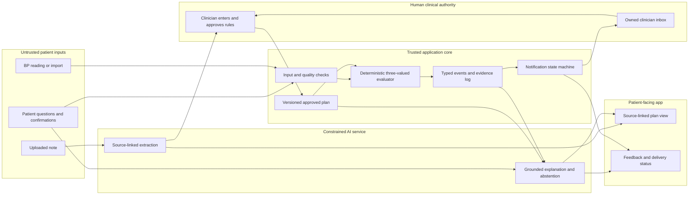

# Care Plan Bridge — revised product and hackathon MVP

- **Date:** 19 September 2026
- **Status:** revised after [Claude's critique](./FRAMEWORK_CRITIQUE.md). This document makes prototype decisions; it does not claim clinical suitability.
- **Selected challenge:** “AI Healthier Every Day: Intelligent Support for Long-Term Care” in the [hackathon brief](./AI_CAN_DO_IT_Hackathon_Singapore_2026_Brief.pdf).
- **Submission deadline:** [16 October 2026](https://tch.tencentcloud.com/contest/44).
- **Prototype cohort:** an older adult with a clinician-provided hypertension plan, matching the brief's third long-term-care example.
**Project name:** Care Plan Bridge. The repo name `aura-health` is a working repository name, not a second product name.

## 1. Product proposition

**Short blurb for submission (8 words):** “Make clinician care plans usable at home.”

The patient already has a care plan but may not know exactly what to measure, when, what the readings mean **relative to that plan**, or whether a care-team message was actually received. Care Plan Bridge turns the patient's own instructions into a source-linked home workflow. It helps the patient understand those instructions, records objective measurements, detects observable gaps, and creates an evidence packet when a *clinician-approved* condition requires review.

The product's claim is **process fidelity**, not improved BP control or fewer hospital visits. A successful prototype shows that (a) plan instructions are interpreted faithfully, (b) the patient can act on the parts that are clear, (c) uncertain or unreliable data cannot be misrepresented as an all-clear, and (d) the clinician sees the evidence behind a relevant event without receiving every noisy reading.

### What is genuinely different?

This is **not** the first BP tracker, health-plan app, or remote patient monitoring service. [Healthier SG](https://www.healthhub.sg/programmes/hsg) already lets patients and doctors create a personalized Health Plan, view goals, and track screening and vaccination tasks through HealthHub. [Cadence](https://www.cadence.care/welcome) offers connected home readings, a personalized care plan, clinician monitoring, and 24/7 support. We should not claim those capabilities as novel.

The narrow capability we are testing is **document-grounded, uncertainty-aware execution of an individual plan**: the system shows the exact instruction and approved rule behind a home action, distinguishes missing from negative evidence, declines to structure ambiguous instructions, and makes alert delivery and acknowledgement visible. This positioning is a hypothesis to validate against products and clinician workflows, not a market exclusivity claim.

## 2. Entry point and two operating modes

**Mode A — patient-first, unconnected.** The patient or caregiver uploads a copy of a clinician-issued note they already possess. Immediately, AI provides a source-linked reading aid: plain-language explanations of *what the text says*, a list of dates or follow-ups explicitly mentioned, and questions to take to a doctor or pharmacist. The patient can record and view BP readings. This mode makes no new clinical judgement, does not infer missing thresholds, does not activate medication schedules from uncertain prose, and does not say a clinician is monitoring anything. If a passage is ambiguous, it remains a question, not a task.

**Mode B — clinician-connected.** A clinician or authorized care-team member reviews the relevant document and manually sets the monitoring parameters, escalation conditions, contact route, service hours, and fallback. Approved rules activate plan-relative feedback and care-team notifications. The patient can see which items are approved and what the care team will receive.

The distinction must be visible in the interface. “My document says...” and “Your care team approved this monitoring step...” have different authority. The app should never quietly graduate content from Mode A to Mode B. The demo starts in Mode A, shows immediate patient value, then shows the narrow approval step required for connected monitoring.

## 3. Why hypertension is the first scenario

Home BP gives us one objective stream with meaningful variation: timing, repeat readings, technique, stale or missing data, sustained trends, and personalized targets. Singapore's [ACE hypertension guideline](https://www.ace-hta.gov.sg/healthcare-professionals/acg/hypertension---tailoring-the-management-plan-to-optimise-blood-pressure-control-acg/) recognizes home BP monitoring for long-term follow-up and trend review; [HealthHub guidance](https://www.healthhub.sg/health-conditions/heart-failure-monitoring-weight-and-blood-pressure) illustrates why consistent technique and repeat measurement matter, though that particular page addresses heart failure and is not a hypertension protocol.

The first version uses BP readings, explicit patient confirmation of medication taking, and dated follow-up items **only if present in the clinician's plan**. It does not ingest CGM, meals, heart rate, or another condition. The earlier [CGMacros](https://www.physionet.org/content/cgmacros/1.0.0/) idea is cut from the MVP: the dataset has glucose streams but no care-plan interpretation ground truth.

## 4. Patient journey

### Step 1 — understand my plan

The patient uploads a fictional discharge or clinic note. The AI highlights a monitoring instruction, medication text, and a follow-up date, each with a clickable source excerpt. It flags “check BP regularly” as ambiguous and proposes the question “How often should I check?” It can explain an unfamiliar term from an approved glossary; if it cannot identify a medicine or the note conflicts with itself, it says so and offers a pharmacist/clinician question. It never turns a vague phrase into a schedule.

### Step 2 — make the plan usable

Once a fictional clinician approves the monitoring schedule and parameters, the app shows a simple “Today” view: when to measure BP, how to measure according to the approved instruction, whether a reading has arrived, the next follow-up item, and one patient-chosen goal (for example, a preferred measurement time). The patient can set reminder timing within the approved schedule without changing the schedule itself.

### Step 3 — measure and interpret faithfully

The patient enters or imports a BP reading. The system shows whether it is a valid reading, a questionable reading, or missing context. It compares valid readings with the **clinician's** rules. A reading alone cannot prove a dose was missed. If the patient reports a missed dose, that is a patient report and is labelled separately.

### Step 4 — close the feedback loop

If a validated plan condition is met, the patient sees the applicable instruction and a factual status: message created, delivered, acknowledged, or failed. The clinician sees the plan version, the readings, the measurement-quality checks, and the patient's explanation. If the care-team route fails, the patient sees the clinician-approved fallback contact instruction. We do not promise 24/7 care in the prototype.

## 5. AI's specific contribution

| AI task | Why a model helps | Control and output |
|---|---|---|
| Extract candidate meaning from messy clinical prose | Different notes express schedules, exceptions, and follow-ups in varied language. | Candidate fields with exact source spans. High-consequence fields are not executable until human entry and approval. |
| Detect ambiguity and conflict | “Regularly,” missing units, conflicting versions, and conditional instructions require semantic reading beyond a parser. | Flag uncertainty with a specific reason and a question. Score both correct extraction and correct abstention. |
| Explain approved instructions | Patients may need simpler phrasing or an answer tailored to their question. | Retrieve approved passage; produce a bounded explanation with source link; refuse unsupported medication or clinical advice. |
| Check understanding | A patient may paraphrase an instruction incorrectly. | Compare a voluntary teach-back response with the approved instruction; respond with a clarification or question, not a clinical judgement. |
| Prepare evidence summaries | Clinicians need an intelligible narrative rather than a raw stream. | Summarize typed events and readings, preserving labels for measured, patient-reported, and unresolved facts. |

**The model does not decide that a reading meets a clinical threshold or choose a care route.** A deterministic evaluator applies clinician-entered parameters and returns a typed result. We should show the difficult AI work in the demo: an ambiguous phrase correctly withheld, an apparent document conflict found, an attempted prompt injection treated as document text, and a grounded explanation that refuses to invent an answer. That is deeper than a chatbot and makes the guardrails visible.

## 6. Clinician approval that resists automation bias

The clinician review is narrower than in [v1](./PRODUCT_FRAMEWORK.md): it covers executable monitoring and contact rules, not every patient-facing explanation. It still needs real controls against a plausible but wrong AI extraction.

1. The reviewer sees the **source passage first**, without an AI-proposed numeric threshold or contact route prefilled.
2. They manually enter or confirm all high-consequence fields: threshold, units, timing/window, repeat requirement, priority, contact destination, hours, fallback, and behavior when data are unknown. The AI proposal appears only afterward as a comparison, not as a default answer.
3. The system highlights disagreement between source text, AI candidate, and entered rule. A rule cannot be approved with required fields missing.
4. Approval is per rule. A routine explanatory summary can remain available while an ambiguous rule remains inactive.
5. Approval time and edits are logged. Implausibly fast approval is a review signal, not proof of error.

**Limit:** the hackathon can demonstrate this control but cannot establish that it prevents clinician automation bias. That needs actual clinician reviewers. We will not describe a simulated clinician click as clinical validation.

## 7. Explicit decision model

For each active rule, evaluation can return `true`, `false`, or `unknown`. `Unknown` is a first-class outcome with a **required** rule-specific action. It must never silently become `false` or “all clear.” The rule evaluator works from the active plan version and typed observations only.

Illustrative **executable shape** (the fictional clinician supplies `systolic_review_threshold_mmHg` at setup; no universal threshold is asserted):

```json
{
  "ruleId": "bp-review",
  "planVersion": "fictional-v2",
  "sourceSpanId": "note-2:p2:para4",
  "input": {"type": "home_blood_pressure", "unit": "mmHg"},
  "condition": {
    "all": [
      {"field": "systolic", "op": ">=", "valueFrom": "plan.systolic_review_threshold_mmHg"},
      {"field": "quality", "op": "=", "value": "valid"}
    ],
    "repeat": {"countFrom": "plan.review_repeat_count", "withinFrom": "plan.review_window"}
  },
  "onTrue": "create_clinician_review_case",
  "onFalse": "show_plan_progress",
  "onUnknown": "request_clarification_and_apply_unknown_route",
  "onUrgentUnverified": "apply_approved_unverified_route",
  "onSilence": "apply_approved_missing_data_route",
  "approvedBy": "fictional-clinician-7"
}
```

The rule engine supports a small fixed operator set; it does not execute natural-language conditions. At approval time, it rejects references to undefined plan parameters. `onUnknown`, `onUrgentUnverified`, and `onSilence` must be specified when the rule is designated high priority.

### Asymmetric quality handling

A quality warning must not simply discard a potentially concerning measurement. The pipeline checks identity and whether a reading is parseable, then evaluates **both** quality status and whether the numeric value *would* meet any clinician-designated high-priority condition. A questionable reading that could meet such a condition becomes `urgent_unverified`, which follows the clinician's pre-approved action. The patient sees “This measurement may be unreliable, but it may need attention under your plan,” plus the exact repeat or contact instruction. It is never shown as normal. This does not mean every poor-quality reading pages a clinician: the plan specifies the route and urgency.

If the device cannot establish that the reading belongs to the patient or the value is unparseable, there is no numeric interpretation. The system uses the plan's `onUnknown` action and communicates that data could not be checked. A high-priority condition must not be suppressed merely because an input is stale or technically imperfect; the relevant fallback is explicit.

### Sustained silence and deduplication

A missing reading is not evidence of patient failure or clinical stability. The clinician can set a **silence rule**—for example, how many scheduled measurements may be missed before the care team should check in. If there is no silence rule, missing measurements remain patient reminders or routine summaries. The prototype must show this choice.

The MVP's deduplication is deliberately simple: one unresolved case per rule within a configured window, with every new observation visible in the case. A worsening observation or new high-priority rule result opens or upgrades a case; it cannot disappear into a prior low-priority notification.

## 8. Evidence chain and event states

Every substantive message can be traced through:

`source document → source span → clinician-entered/approved rule → observation and quality state → evaluation → patient message → clinician delivery state`.

The key data states are:

| State | What it means | What it does not mean |
|---|---|---|
| `measured_valid` | A sourced, timely measurement passed defined checks. | That treatment was followed. |
| `measured_unverified` | A parseable value exists but a quality condition failed. | That the value is harmless or false. |
| `missing` | The app did not receive the scheduled data. | The patient did not perform the measurement. |
| `patient_reported` | The patient or caregiver asserted an action or barrier. | Device or pharmacy confirmation. |
| `plan_unresolved` | Required instruction or parameter lacks approval. | A normal clinical result. |
| `alert_generated` | An event was created for routing. | That a clinician received it. |
| `alert_delivered` | The destination accepted the message. | That someone read or acted on it. |
| `alert_acknowledged` | An assigned person acknowledged the case. | That clinical follow-up is complete. |

**Suppression audit:** for each plan-defined high-priority scenario in the test corpus, record whether the event was escalated, withheld, or rerouted and why. This specifically exposes false reassurance created by quality filters, unknown values, or deduplication.

## 9. Architecture and trust boundaries



The diagram shows the patient input return path and the authority boundary. AI output never enters the evaluator as an active rule. The notification service consumes typed events, not a model-generated sentence. Source documents are data; instructions embedded in them cannot control the system.

**Key trade-offs:** patient-first explanation creates immediate value but cannot promise active monitoring; clinician-entered rule fields improve safety but create setup effort; narrow BP-only scope lowers clinical and engineering complexity but delays multi-condition value; deterministic evaluation is less flexible than an AI judgement but supports audit and replay; a fictional inbox demonstrates workflow but cannot validate operational responsiveness.

## 10. Clinician feedback operation in the MVP

The demo uses a **fictional weekday clinic inbox, 09:00–17:00 Singapore time**, an explicitly assigned fictional nurse, and a fictional after-hours contact instruction inside the approved plan. These are demonstration fixtures, not a promised service. One high-priority route and one routine digest route are sufficient.

The patient sees delivery status. If delivery fails or an acknowledgement timeout is reached, the interface displays the plan's fallback instruction and marks the case unresolved. The app does not say “a clinician is watching” unless a staffed monitoring arrangement exists. The care team sees new measurements in an existing case and can acknowledge, ask a question, or close it with a reason.

## 11. Preventive care and patient agency

The brief explicitly mentions preventive health and healthcare preparation. The MVP supports **follow-up items already in the patient's plan**: appointments, screenings, vaccinations, or refill reviews. It does not invent a screening schedule or claim a vaccine is due without an approved source. These appear as positive, useful home tasks, not alerts. The patient can add personal goals and preferred reminder times, but these preferences cannot alter clinician-set clinical conditions.

A pre-visit summary separates objective readings, patient-reported barriers, uncompleted follow-ups, and questions for a doctor or pharmacist. The patient can choose which optional personal notes to share. This gives the patient agency beyond passively receiving warnings.

## 12. Evaluation plan and honest claims

### Hackathon evaluation with synthetic data

Create two fictional notes, one approved plan, one revision, and a small labelled set of variants with poor OCR, missing units, ambiguous timing, contradicting text, and an instruction-injection attempt. Write expected outcomes before implementing AI. Simulate BP streams with routine readings, an isolated outlier, a questionable potentially high-priority reading, unknown input, sustained missing measurements, and a confirmed plan condition.

Compare AI extraction with a hand-labelled answer key for field accuracy, source-span accuracy, ambiguity detection, and false confidence. Compare the rule evaluator against an exhaustive boundary test matrix. Test patient explanations for unsupported claims. Record every alert the baseline and product generate on the same synthetic stream.

**Prototype gates:** all active rules have manual clinician approval and source spans; no unsupported rule activation in the curated test suite; no `unknown → false` conversion; all high-priority synthetic events are accounted for in the suppression audit; no “delivered” status before receipt. Passing these gates proves prototype behavior on the curated cases, not safety for patient use.

### Process metrics for the submission

- Plan instructions correctly mapped to source passages in the labelled corpus.
- Ambiguous or contradictory instructions correctly withheld, and clear instructions unnecessarily withheld.
- High-priority plan conditions detected on their first eligible evaluation.
- High-priority conditions suppressed or rerouted, with reasons.
- Clinician alerts per simulated patient-week compared with a simple threshold-only baseline on the same stream.
- Share of alerts with a complete evidence chain.
- Time to understand a case in a small simulated review task, if external reviewers are available.

Actual clinician review, patient comprehension testing, and operational response-time validation are **post-hackathon studies** unless we recruit participants. A simulated clinician approval is a demonstration of the mechanism, not evidence that real clinicians catch AI mistakes. [Singapore AIHGle 2.0](https://isomer-user-content.by.gov.sg/3/2a43b2e0-1cec-4d35-af8a-da74bc2410e2/Updated%20AIHGle%202.0.pdf) calls for human oversight and deployment-context validation. The product's intended-use and [HSA software medical device](https://www.hsa.gov.sg/docs/default-source/hprg-mdb/guidance-documents-for-medical-devices/gl-04-r4-regulatory-guidelines-for-software-medical-devices---a-life-cycle-approach-%282025-dec%29-pub.pdf?sfvrsn=857a2001_1) status must be reviewed before live use.

## 13. Scope, timeline, and submission package

**Must build:** patient upload and source-linked reading aid; a “Today” screen; one BP import/manual stream; AI ambiguity/conflict detection and grounded question answering; manual clinician approval of one rule; typed evaluator with unknown and unverified routes; preventive follow-up task from source; clinician evidence card; generated/delivered/acknowledged states; deterministic replay of demo cases.

**Mock or defer:** device and EHR integrations, CGM, multilingual answers, caregiver UI, real outbound messages, sophisticated deduplication, real service-hours calendar, live clinical use, and FHIR exchange. We may organize records so future integration with [FHIR CarePlan](https://hl7.org/fhir/R4/careplan.html), [Observation](https://hl7.org/fhir/R4/observation.html), and [Task](https://hl7.org/fhir/R4/task.html) is possible; no interoperability claim is made for the MVP.

| Dates | Deliverable |
|---|---|
| 19–23 Sep | Decide fictional patient, plan, approval parameters, and expected event outcomes. Write the adversarial corpus and demo storyboard. |
| 24 Sep–1 Oct | Build typed plan, approval, evaluator, quality/unknown paths, and replay tests. |
| 2–8 Oct | Build patient-first document aid, ambiguity/conflict detection, grounded explanations, and patient UI. |
| 9–12 Oct | Build clinician evidence card, notification states, fallback drill, preventive task, and basic accessibility pass. |
| 13–15 Oct | Run demo rehearsal; make cover image, architecture/trust-boundary slide, concise impact metrics, repository and video; submit before the deadline. |

The exact split depends on team size and availability, which we have not yet recorded. If time is constrained, preserve **one complete patient → approved plan → objective reading → evidence-backed clinician event** path before adding more document variants.

**Submission checklist:** project title “Care Plan Bridge”; blurb under 10 words; project description with target user, problem, architecture, AI prompts/behavior, and quantified process impact; GitHub source; live demo walkthrough; architecture diagram with trust boundaries and trade-offs; required 16:9 cover image; optional 5–8 minute video and live URL; **at least three authentic CodeBuddy or WorkBuddy development screenshots or screen recording**. The [brief](./AI_CAN_DO_IT_Hackathon_Singapore_2026_Brief.pdf) says proof of CodeBuddy/WorkBuddy use is mandatory for scoring. Capture it during development, not retrospectively.

## 14. Five-minute demo arc

1. **Patient value, first (45 sec):** fictional older adult uploads a clinic note; sees plain-language, source-linked instructions and a preventive follow-up.
2. **AI depth (60 sec):** the model spots “regularly” as ambiguous, catches a conflict in a revision, and refuses a medication question unsupported by the note. An injected instruction in the note is treated as untrusted text.
3. **Clinical authority (45 sec):** clinician manually enters a target and alert route; the AI candidate is revealed as a comparison; the rule is approved.
4. **Home data (75 sec):** one questionable reading triggers the `urgent_unverified` path, then valid readings meet a plan-defined condition. Show that the system did not treat missing data as normal and did not invent missed medication.
5. **Payoff (45 sec):** clinician gets one concise evidence card; patient sees delivered then acknowledged. Show a follow-up action and a visit summary.
6. **Failure drill and metrics (30 sec):** simulate inbox outage, show fallback, then display alert-count comparison and suppression audit from the same test stream.

The story follows one patient. Guardrails create the tension; an appropriate, evidence-backed handoff is the payoff.

## 15. Remaining questions that actually block implementation

1. **Team capacity:** how many builders and hours are available before 16 October? The schedule is a proposal until this is known.
2. **Clinician access:** is there a clinician or pharmacist willing to review the fictional plan and demo wording? If not, do not imply external clinical review.
3. **Exact fictional plan:** choose the BP measurement schedule, follow-up task, high-priority rule, `onUnknown`, `onUrgentUnverified`, silence behavior, and after-hours route before coding.
4. **AI platform:** choose CodeBuddy or WorkBuddy for the required development proof and the model service used in the demo; keep clinical data synthetic.
5. **Market validation:** compare this narrow capability directly with Healthier SG and at least one RPM product. If they already solve the same user problem adequately, change the product claim or target user.
