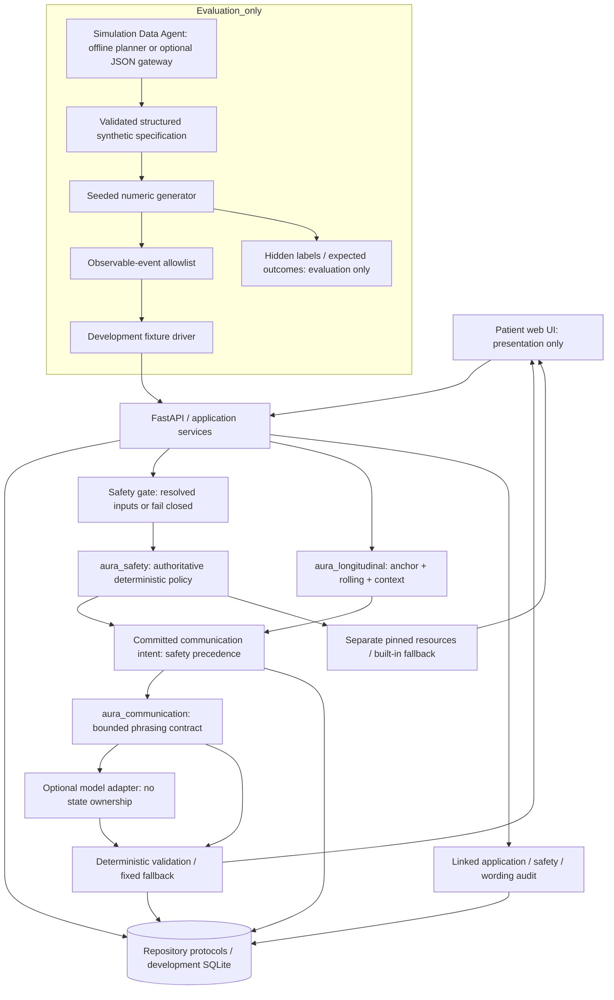

# AURA — implementation and trust boundaries

M7 synthetic engineering prototype. Diagram reflects the code, not clinical validation.

Safety-relevant input reaches the safety boundary before longitudinal/conversational
processing. Unknown assessment fails closed; no model decides policy. Public hosted
demo accepts only named fixtures, rejects other input before persistence, disables
models, disallows patient/anchor creation, and gives each browser a separate synthetic
workspace. No authenticated care or real-data intake is provided.

Only observable values, structured patient reports, explicit context links, and
resolved fixture proposals cross the evaluation boundary. The production modules do
not import `aura_simulation`; scenario labels and latent truth cannot affect decisions.
DEMO2 mutates hidden fields and checks identical observable frames and committed
states/actions. DEMO16 checks the import boundary.

The application adapter forwards production-assessed newly meaningful signal evidence
to the **existing** held-record reopening API. No domain threshold or rule is copied.
Anchors require explicit commands. Snapshot selection is a temporary UI preview, not
approval or transmission. Fixture resources are unverified and contain no invented
crisis contacts. Live generation requires future consent/content governance.
