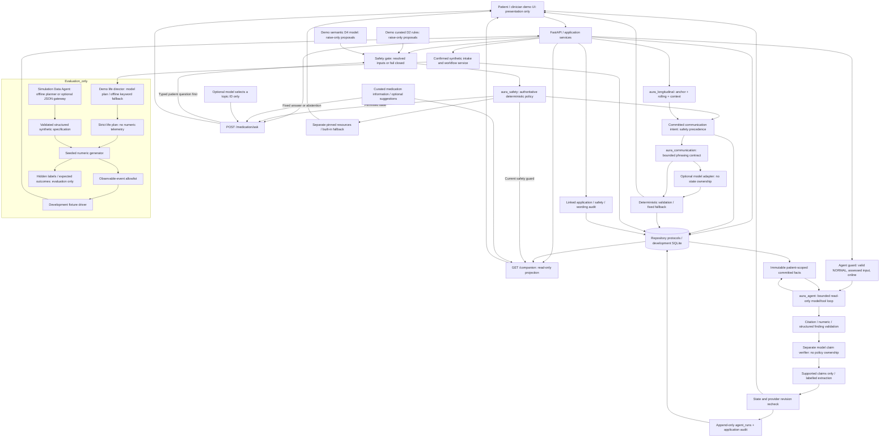

# AURA — implementation and trust boundaries

M7 synthetic engineering prototype. Diagram reflects the code, not clinical validation.
The attached PDF was audited against `90e31ea` on2026-10-14; see
[the review and corrected exports](submission/ARCHITECTURE_REVIEW.md).

Safety-relevant input reaches the safety boundary before longitudinal/conversational
processing. Unknown assessment fails closed; no model decides policy. Public hosted
demo accepts bounded synthetic manual/import/context and safety-gated text alongside
named fixtures. It allows operator-configured synthetic-only models, disallows
public patient/anchor creation, and gives each browser a separate synthetic
workspace. No authenticated care or real-data intake is provided.

Only observable values, structured patient reports, explicit context links, and
resolved fixture proposals cross the evaluation boundary. Production event/safety/
longitudinal modules do not import `aura_simulation`; scenario labels and latent
truth cannot affect decisions. The explicit synthetic-only workflow adapter
invokes the generator and submits observable events through the same application
service; plans/truth remain in workflow traces.
DEMO2 mutates hidden fields and checks identical observable frames and committed
states/actions. DEMO16 checks the import boundary.

The application adapter forwards production-assessed newly meaningful signal evidence
to the **existing** held-record reopening API. No domain threshold or rule is copied.
Anchors require explicit commands. Snapshot selection is a temporary UI preview, not
approval or transmission. Fixture resources are unverified and contain no invented
crisis contacts. Real-patient live generation requires future consent/content governance.

The read-only product agent is separate from the Simulation Data Agent. It may
investigate and draft, never decide safety/drift, move anchors, establish context
credibility, authorize interruption or share records. No write tools exist.
Tools exclude latent truth and use opaque model-facing source aliases; displayed
citations still identify real committed records. Offline extraction is not AI.
See [current agent/intake/simulator implementation and limits](APPROVED_AGENT_AND_SIMULATOR_IMPLEMENTATION.md).

The integrated companion presents medication understanding, today's patient-reported
dose with optional skipped-dose reasons, displayed review/refill dates and optional
curated suggestions. `GET /companion` never moves anchors or runs an LLM. Typed
medication questions pass safety first; any model classification chooses a topic,
not treatment instructions. Unknown medication/topics abstain. Content needs
pharmacist/sponsor review; displayed dates are not push reminders or booked visits.
Seven-day routine counts are latest-per-local-day reports for the synthetic
once-daily regimen; missing/unknown days are not missed doses. See
[companion backend contracts](PATIENT_COMPANION_BACKEND.md).
