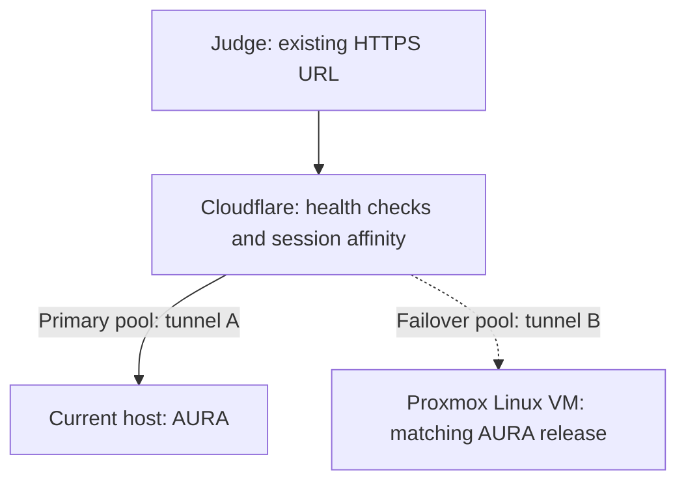

# Judging availability — planning, 2026-10-15

User: Claude is making bug fixes; plan how to make AURA robust for judging. An unused Proxmox host is running with no VM. No provisioning, code changes, routing changes or purchases requested in this discussion.

## Recommendation

Provision one Linux VM on Proxmox as a running, tested standby for the current application host. Once each origin works independently, consider Cloudflare Load Balancing with ordered primary/standby pools, separate Tunnel UUIDs and cookie session affinity. Keep the public judging URL unchanged. This is a proposal, conditional on accepting session restart after failover and verifying the account's available features/cost.

An external routing service avoids putting the only load balancer on the host whose failure it must survive. A standby in the same building helps with individual machine failures; shared power, router and ISP failures still affect both. An independently hosted cloud standby would cover more of those failures. No Proxmox cluster is needed for this proposal: it is an application standby on a second physical machine.

## Verified application constraints

Source inspected on Codex branch `24135df`; Claude's ongoing fixes and actual live deployment configuration were not independently inspected in this planning session.

- `aura_app/hosted.py`: session mappings are process-local (`self.sessions`); each workspace is a local SQLite clone. Unknown session cookies on patient API calls return409; only `GET /demo/scenarios` can bootstrap a workspace. Switching origins therefore requires explicit recovery/bootstrap, not just routing a request elsewhere.
- `Dockerfile` uses one worker; `docs/DEPLOYMENT.md` requires one worker for this store. Ordinary round-robin between independent instances would lose session continuity. Sticky routing helps while the origin is healthy; it does not replicate sessions or preserve an in-flight model call on failure.
- `/health` returns a fixed JSON status without testing database read/write or session capacity. Useful for basic reachability, insufficient to claim the complete demo works.
- Compose defaults are16 concurrent workspaces, one-hour idle TTL,2 CPU and1GiB container memory, and30/300 model calls per minute/hour. These are configuration defaults, not measured judging capacity or verified live limits. A second host does not resolve an upstream model outage or shared provider quota.

Do not share a writable SQLite volume between independent machines as a shortcut. Seamless continuation would require a separately scoped session/storage redesign. For a synthetic judging demo, a clearly explained fresh-session recovery is likely the smaller change, subject to the user's answer.

## Proposed sequence after approval

1. Freeze a reviewed release after Claude's fixes. Record its commit/image, rollback target and synthetic baseline. Run the same release/configuration on both origins; provision provider settings securely on each without copying secrets into git. Start with a modest VM allocation (e.g.2vCPU/4GiB RAM/30GiB disk), then size from measured behavior; this is a starting estimate.
2. Establish the standby independently, initially through a separate test hostname/tunnel. Confirm HTTPS, assets, isolated sessions, medication/calendar/sharing flow and the actual Q&A path. Pin deployment artifacts; verify automatic startup after a VM/host reboot. Preserve a manual backup URL as an operator fallback.
3. Add cheap readiness checks for essential local functions (baseline availability, database access/storage and ability to serve requests). Keep model-provider checks separate and infrequent; do not make every health probe generate an AI answer. Distinguish process failure, dependency failure and new-session capacity; do not move established visitors just because new-session capacity is exhausted.
4. Configure external health-based primary/standby routing with separate tunnels and sticky sessions. Verify feature availability, monitoring interval, unhealthy/healthy thresholds and cost before purchasing/enabling. Test failback so a recovering primary does not bounce existing standby sessions. Do not blindly retry POST writes across origins.
5. If a fresh demo on failover is accepted, define a small explicit recovery flow for the existing409 session response: tell the visitor the session was interrupted and let them restart. Do not imply their previous edits or in-flight answer survived. Replication and seamless recovery remain outside this smaller plan.
6. Rehearse controlled failures before judging: stop primary app, stop primary tunnel, interrupt primary network, restore primary, restart standby, and simulate unavailable/slow AI. Measure time until a visitor can resume a usable demo. Check both a new visitor and a visitor already exploring. Use synthetic sessions and bounded model calls.
7. Run a small representative concurrent-visitor rehearsal. Measure new-session bootstrap, normal API latency, Q&A queue/timeout behavior, memory, disk growth and rate-limit feedback. Set session limits from results; do not assume16 sessions means16 simultaneous model generations are comfortable. Keep existing safety/grounding and model budgets intact unless separately changed.

Maintain an independently accessible walkthrough video for a widespread outage. It complements live failover; it does not prove the app is available.

## Decisions pending

Tencent ADP follow-up (2026-10-15): assuming ADP means Agent Development Platform, its documented purpose is building/publishing agents and workflows with API/SDK integration into existing applications. Those docs do not establish a drop-in hosting path for AURA's complete FastAPI/UI/SQLite container. Adopting it for AURA's agent layer would require integration and revalidation, rather than merely moving the current server. For minimal-change Tencent hosting, a CVM instance with persistent storage is the closer architectural fit; the existing hostname can be retained through DNS/HTTPS or the edge proxy. This is a recommendation, not a selected service or provisioned deployment. Sources: [ADP overview](https://intl.cloud.tencent.com/document/product/1254/69956?lang=en), [developer integration](https://intl-sg.tencent-cloud.com/document/product/1254/78763), [CVM](https://www.tencentcloud.com/products/cvm).

Cloud Run follow-up (user, 2026-10-15): the existing `https://aura-health.makodev58.com` hostname can be retained when changing hosting. Google's recommended custom-domain path is an external Application Load Balancer; a correctly configured third-party edge proxy is another option. The hostname's DNS/routing and HTTPS configuration must point to the new service; a plain CNAME to its default URL is not the complete setup. Native domain mapping is currently Preview/limited availability. See [Google's domain documentation](https://docs.cloud.google.com/run/docs/mapping-custom-domains).

Cloud Run is not a drop-in reliability improvement for AURA's present session/store design: its default writable filesystem is in memory and not persistent across instance shutdown, and affinity is best effort. Replacements can lose local workspaces even if minimum instances are configured. Robust multi-instance use needs external session/data storage. A Compute Engine VM with persistent disk is a closer fit for the existing deployment, subject to normal single-host availability limits. No cloud service selected or provisioned. Sources: [runtime contract](https://docs.cloud.google.com/run/docs/container-contract), [session affinity](https://docs.cloud.google.com/run/docs/configuring/session-affinity).

- Does Proxmox share the current host's location, power, router and internet connection?
- Is restarting a synthetic demo session after failure acceptable, or must the judge's same session survive?
- Is Cloudflare currently the live ingress, and is its load-balancing feature available/acceptable on the account? Repository tunnel configuration is evidence of support, not verification of the current account.
- Expected simultaneous judges/visitors and required availability window; uptime/recovery target to measure rather than promise.

## Official references checked

- [Cloudflare Tunnel routing](https://developers.cloudflare.com/tunnel/concepts/routing/): independent tunnel UUIDs for granular endpoint steering/session affinity; replicas of one tunnel are treated as one endpoint.
- [Cloudflare failover steering](https://developers.cloudflare.com/load-balancing/understand-basics/traffic-steering/steering-policies/standard-options/): ordered pools, health monitoring and failback behavior.
- [Cloudflare session affinity](https://developers.cloudflare.com/load-balancing/understand-basics/session-affinity/): cookie routing stays with a healthy endpoint and changes when that endpoint is unhealthy. Session data replication is the application's responsibility.

Planning verification: repository source/configuration and official routing documentation only. No live outage, load test, model call, Proxmox access or deployment performed. Historical review tests do not establish failover readiness.
