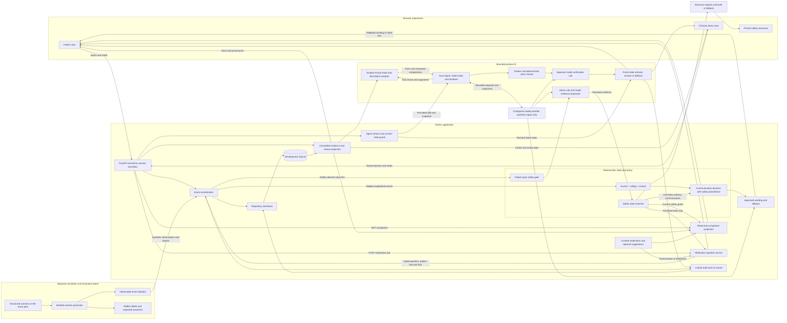
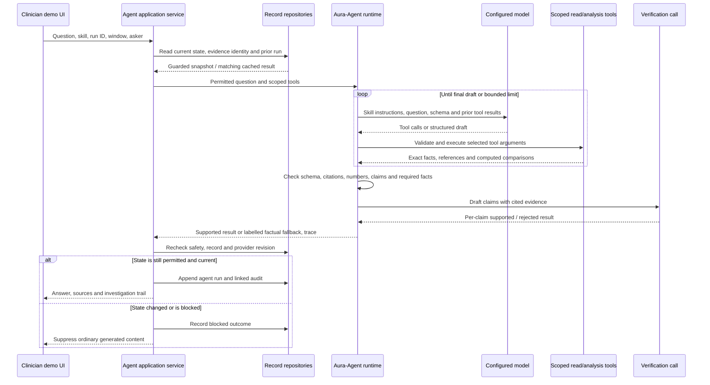

# AURA Health — Detailed Architecture and Diagram Specification

Reviewed: 2026-10-14 against `90e31ea` (current `origin/main` at review start).
Original inventory: `3d95a66`; companion integration: `f37af0c`.
The attached architecture PDF audit and corrections are in
[ARCHITECTURE_REVIEW.md](ARCHITECTURE_REVIEW.md).

Chosen challenge: Healthcare Challenge Statement2 — "AI Healthier Every Day:
Intelligent Support for Long-Term Self-Care", Scenario1 — "Mental Health Maintenance
for Working Adults on Antidepressants". The presentation and required architecture
upload use one deck: `docs/submission/assets/aura-health-deck.pptx`.
Current editable diagrams are generated by `docs/presentation/deck/native_diagrams.py`;
PNGs are in `docs/presentation/diagrams/`. The older SVGs are historical.

This is the source document for generating the submission architecture diagram.
It describes the implemented synthetic demonstration, with future architecture
explicitly separated. It is not a deployment change or a clinical validation claim.
The repository may receive concurrent presentation changes; this document records
the backend and trust boundaries inspected at the commit above.

The integrated patient companion adds read-only `GET /patients/{patient_id}/companion`,
curated medication information, dose/reason records, review/refill dates and optional
curated suggestions. Typed `POST /patients/{patient_id}/medication/ask` questions
are patient free text: safety processing precedes topic selection and curated
answers. These are application projections/content services, not a new domain
engine or an autonomous medication agent. See §6.1 and
`docs/PATIENT_COMPANION_BACKEND.md`; final release checks are separately versioned.

## 1. Architecture in one paragraph

AURA connects a quiet patient interface and an analytical clinician interface to
one Python application backend. Application services commit patient events, invoke
deterministic longitudinal and safety engines, and persist their decisions through
repository interfaces backed by development SQLite. A separate, bounded Aura-Agent
investigates committed records using patient-scoped read and analysis tools. The
model chooses investigative steps and drafts cited answers; deterministic checks,
a separate model verification call and a fresh-state guard control what is shown.
Safety resources have their own rendering path. Synthetic generation and evaluation
form a separate plane whose hidden scenario truth does not enter product decisions.

**Diagram headline:** Personal context, agent-led investigation, deterministic policy.

**Core principle:** Signals propose. Rules dispose. The LLM phrases.

## 2. Scope and audiences

The intended product supports adults approximately 25–60 on stable,
clinician-managed antidepressant maintenance treatment. It organizes personal
patterns, reported context, medication routines and information for appointments.
The current hosted application operates on synthetic data only.

| Actor | Implemented interaction | Boundary to show |
|---|---|---|
| Patient demo user | Calm recap; medication information; today's dose and reasons; coming-up dates; optional suggestions; check-ins, questions/explanations and appointment preparation | Inputs go through application services; the browser owns presentation, not domain policy |
| Clinician demo user | Source-linked findings, historical charts, record Q&A, comparisons and review preparation | The demo toggle exposes the synthetic record; it is not authenticated clinical access |
| Demo operator | Provider/model configuration and synthetic scenario controls | Operator settings are separate from ordinary patient interactions |
| Sponsor / future institution | Intended owner of clinical parameters, content and deployment decisions | Future governance and institutional authorization are not supplied by the demo |

Do not depict diagnosis, relapse prediction, suicide-risk scoring, medication
changes, psychotherapy, emergency monitoring or automatic clinician notification
as system outputs.

## 3. Diagram composition and notation

Generate one overview diagram plus optional detail diagrams. A single slide should
not attempt to contain every table, tool and sequence in this document.

### Overview layout

Use a landscape 16:9 canvas with these regions:

1. **Left — Experience:** Patient view and Clinician view inside one browser box.
2. **Center — Application and deterministic policy:** FastAPI above application
   orchestration; longitudinal and safety engines beside one another below it.
3. **Right — Bounded AI:** Aura-Agent, scoped tools, validation and verifier;
   configurable model gateway at the outer right edge.
4. **Bottom center — Persistence:** repository boundary above development SQLite;
   a trace/audit label beside it.
5. **Bottom left — Simulation and evaluation:** visibly separate shaded region;
   only observable events cross into the application.
6. **Independent return path — Safety resources:** safety policy to pinned resources
   to browser, outside the generated-answer path.

Use solid arrows for implemented data/control flow, dashed arrows for
configuration, and dotted outlines for future components. Label arrows with what
crosses them. A connection indicates a software call/data flow, not necessarily a
network hop. These Python modules run within an application deployment; they are
not separately deployed microservices.

Suggested colors: blue for deterministic components, lilac for model-assisted
components, warm gray for storage, pale amber for simulation, coral for safety
priority. Add text labels so color is not the only distinction. Use the existing
AURA warm off-white background and readable dark text.

### Mandatory visual distinctions

- State ownership is deterministic; model investigation is probabilistic.
- Aura-Agent has read/analysis tools, not write or treatment-action tools.
- Model-assisted safety detection proposes evidence; the safety engine decides.
- Product AI and the Simulation Data Agent are different components.
- The verifier is a separate model call, not proof of clinical correctness or
  necessarily a different model/provider.
- Live model use is implemented for synthetic data; institutional on-prem/private
  cloud hosting belongs in the future inset.
- The clinician view does not imply automatic sharing or production authorization.

## 4. Component inventory

| ID | Diagram label | Responsibility | Implementation |
|---|---|---|---|
| UI | Patient / clinician web experience | Responsive HTML/CSS/JavaScript, input collection, source disclosures, charts, recap, Q&A and review preview | `aura_ui/` |
| API | FastAPI transport | Validate request shape, call services, return structured responses; serve local assets | `aura_app/api.py` |
| HOST | Synthetic demo workspace | Browser-session isolation, allowed demo routes, workspace selection and model-call allowance | `aura_app/hosted.py`, `demo_workspace.py` |
| APP | Event orchestration | Patient/consent validation, idempotency, event routing, safety precedence, transaction and audit | `aura_app/service.py` |
| LP | Longitudinal adapter | Replay eligible events into accepted longitudinal components and project their results | `aura_app/longitudinal.py` |
| LONG | Longitudinal engine | Governed anchor, adaptive rolling reference, missingness, descriptive change, signal-scoped context and held items | `aura_longitudinal/` |
| GATE | Patient-input safety gate | Resolve input evidence or represent assessment failure; no general conversation before patient-input assessment | `aura_app/safety.py`, `aura_detectors/` |
| SAFE | Deterministic safety policy | Validate state, apply transitions, preserve episode provenance and enforce sequence/CAS rules | `aura_safety/engine.py`, `domain.py`, `config.py` |
| WORD | Approved interaction wording | Phrase permitted communication intents, validate output, choose deterministic fallback | `aura_communication/`, `aura_app/communication.py` |
| READ | Committed evidence projection | Patient view, history, sources, baselines, context and review snapshot | `aura_app/evidence.py`, `patient_view.py`, `service.py` |
| ARRIVE | Guarded arrival assessment | Immediate source extraction and fingerprint-matched cached summary; identifies permitted generation request | `aura_app/assessment.py` |
| AGS | Agent application boundary | Skill/request validation, patient-question routing, safety/state guards, run identity, final recheck and persistence | `aura_app/agent.py` |
| AGENT | Aura-Agent runtime | Bounded model/tool loop; selects investigations and produces structured cited drafts | `aura_agent/runtime.py`, `roles.py`, `skills/` |
| TOOLS | Scoped read / analysis tools | Read committed facts and calculate descriptive comparisons within the selected record/window | `aura_agent/tools.py` |
| CHECK | Output grounding and claim checks | Citation, exact-number/date, schema, prohibited-claim and presentation checks | `aura_agent/grounding.py`, `schemas.py`, `presentation.py`, `voice.py` |
| VERIFY | Independent claim verification call | Compare draft claims with their supplied supporting facts; reject unsupported claims | `aura_agent/tasks.py`, `runtime.py` |
| MODEL | Configurable model gateway | Provider/model selection and bounded external inference | `aura_agent/providers.py`, `aura_communication/vendor.py`, `aura_app/system_settings.py` |
| REPO | Repository / unit-of-work interfaces | Keep service code independent of SQLite access details | `aura_app/repositories.py` |
| DB | Development SQLite | Store typed events, projections, state, references and results | `aura_app/persistence.py` |
| RESOURCE | Pinned safety resources / local fallback | Provide resources independently of generated wording and live registry availability | `aura_safety/resources.py`, `output.py`, `offline.py`; UI rendering |
| WORK | Confirmed synthetic workflows | Manual input, import/context proposals and explicit confirmation; simulator controls | `aura_app/workflows.py` |
| SIM | Synthetic planning and generation | Structured plans, seeded observable events, replay and evaluation-only truth | `aura_simulation/`, `aura_longitudinal/synthetic.py`, simulator/evaluation modules |

## 5. Primary overview diagram

This Mermaid source can be used directly or translated into editable diagram
shapes. The detail sections below resolve the meaning of each arrow.

The direct APP-to-REPO line represents both event writes and committed outputs.
The READ line represents repository-backed reads, not an independent database
connection exposed to a model. The actual model gateway is shared by several
bounded uses; those uses are not all autonomous agents.

## 6. Event ingestion and state ownership

An application event carries `event_id`, `patient_id`, `event_type`, `occurred_at`,
`received_at`, `source`, `payload`, `correlation_id` and `idempotency_key`.

Implemented event families include wearable observations, check-ins, medication
events, context events/explanations, structured assessment responses, patient free
text, anchor commands and review commands. Public hosted routes deliberately
expose a smaller synthetic interface than the base development API.

### 6.1 Patient companion and medication-question paths

`aura_app/companion.py` reads committed treatment/events/evidence within a repository
transaction. It does not write anchors, replay policy or generate prose. Response
fields are `safety_normal`, `medication`, `dose_today`, `adherence`, `coming_up` and
`suggestions`. A non-normal/degraded/unassessed-input guard suppresses ordinary
content before content callbacks run.

- **Medication:** `aura_agent/medication.py` reads `medication_info.json` for three
  medications and five topics. Stored prescription/schedule is shown; no dose is
  inferred. Content is labelled development content requiring pharmacist review.
- **Dose:** Taken submits ACKNOWLEDGED; Not yet submits no event; Skipped submits
  one MISSED record with an optional categorical reason. UNKNOWN/unrecorded days
  stay separate from missed days. Seven-day counts use the latest report per local
  scheduled day for the once-daily synthetic regimen, not verified ingestion.
- **Coming up:** next_review and last_refill + supply_days produce displayed
  medication-review/refill dates. No push notifications, booking, refill orders
  or invented appointment item exist.
- **Suggestions:** `suggestions.py` selects optional curated choices from committed
  descriptive changes. It neither assigns a tier nor creates treatment instructions.
- **Medication ask:** `aura_app/medication_ask.py` commits and safety-assesses a typed
  patient question before matching a topic. Topic chips read curated content only
  under the current safety guard. Deterministic keywords, or optional structured
  `medication_topic` model classification, choose only an approved topic ID. The
  response is curated text or a fixed abstention/redirect, never an LLM-written
  medication answer. The UI refreshes safety after typed questions.

The medication question's patient-event commit and later answer lookup are separate
operations, not one transaction across inference. A stored safety assessment is
retained even if classification fails; the fallback is abstention. Dose reasons
remain typed history and linked Not-shared review records. No medication-agent write
tool, clinical scheduling service or conversational memory should be drawn.

Open integration finding at this inspected version: changed text submitted under
the same medication-question run ID can reuse the prior safety-event result. The
ordinary UI creates fresh IDs, but the API needs question-bound identity or a
conflict rejection. See `EVIDENCE_LEDGER.md`; the diagram describes the intended
implemented route, not certification that every retry edge is safe.

### Ordered ingestion flow

1. API validates transport input and calls `PatientEventService`.
2. Service validates identifiers/patient and looks up the patient-scoped
   idempotency key. A committed match returns the prior result with a replay flag.
3. Enforce applicable consent and event rules, then persist the event and typed
   normalized records within the current transaction.
4. Assess safety-relevant input through the safety boundary before ordinary
   longitudinal processing. Patient payloads cannot directly submit safety tiers
   or detector-output fields.
5. If assessment is held/degraded, record that condition and defer ordinary
   longitudinal processing. Otherwise replay eligible events through the production
   longitudinal adapter/engine.
6. Combine outputs with safety precedence. An active non-normal or degraded safety
   state overrides an ordinary longitudinal communication decision.
7. Persist projections, review items, safety references, result, timeline and audit.
8. Commit, then return the structured result. Optional generated wording is a
   separate guarded operation over committed state.

### Transaction inset

Draw a bracket around **event + normalized data + domain results + timeline +
audit** labelled “one local database transaction.” An unexpected processing or
persistence exception rolls it back; the API does not report success for a partial
event. A handled safety-gate failure is different: the service commits an explicit
fail-closed/held result and safety evidence, while deferring ordinary processing.
If that commit fails, the transaction still rolls back.

Do not draw the agent's external model loop inside the event transaction. Agent
execution reads a guarded snapshot, runs inference outside those short database
transactions, then rechecks state before persisting/displaying the result.

## 7. Longitudinal engine detail

Draw this as a deterministic pipeline with two distinct reference boxes:

**Covered observations → rolling statistics → current-vs-rolling comparison**

**Governed anchor → rolling-vs-anchor comparison → descriptive changes**

Context, check-ins, medication routine and explanation state inform communication
and retained review information alongside these observations.

- **Anchor:** historical personal reference changed only by explicit permitted
  commands: provisional creation, trust and clinical-review reanchor.
- **Rolling reference:** recent mean/median, spread and trend updated from eligible
  observations. It can adapt without changing the anchor.
- **Sensing:** OBSERVED / UNOBSERVED, tracked independently of baseline trust.
- **Trust:** PROVISIONAL / TRUSTED / REESTABLISHING. Return after a long gap can
  enter REESTABLISHING; a governed exit is still unresolved.
- **Drift:** descriptive current-vs-rolling, rolling-vs-anchor, direction/magnitude
  and coverage; insufficient data remains insufficient.
- **Context:** benign explanations affect explicitly linked signals only; they
  cannot clear unrelated subjective, medication or safety evidence.
- **Held items:** EXPLAINED_HELD_FOR_REVIEW preserves the anchor, change and
  explanation, suppresses duplicate interruption, and can reopen on relevant
  new evidence.
- **Communication:** STAY_QUIET, MICRO_CHECKIN, TARGETED_CLARIFICATION,
  STRUCTURED_ASSESSMENT, CLINICIAN_REVIEW_ITEM or SAFETY_REVIEW_REQUIRED. The last
  delegates safety handling rather than assigning a tier.

### Signal registry inset

`aura_longitudinal/signal_registry.json` records channel identity, units, cadence,
evidence tier, engine enablement and engineering parameters. Show it as dashed
configuration arrows into ingestion/longitudinal processing and evidence labels.
Do not imply a complete sponsor administration UI exists.

Current engine channels include sleep timing/duration, activity, resting heart
rate, HRV, nocturnal respiratory rate and skin-temperature deviation. The latter
three are research-tier additions. SpO₂, blood pressure, thermometer temperature
and weight are display-only by default. Sparse values are not interpolated into
daily readings; coverage is not silently converted into reassuring evidence.

## 8. Safety boundary detail

The state machine owns interaction mode T0–T4, episode lifecycle, peak, flags,
degraded overlay, causes, dropout reason, sequence and episode identity.

Show three boxes in order:

**Patient-input evidence resolution → deterministic transition policy → allowed
interaction/resources.**

Demo rules and a model-based detector can propose concern. Neither the detector nor
Aura-Agent owns the transition. The accepted state engine governs upward merging,
named CAS-protected downgrades, explicit timer events, dropout/re-entry and episode
history. A closed episode is not rewritten by later concern; new concern starts a
new episode with provenance. Degraded is an overlay, not an extra tier.

The product agent's ordinary record investigation requires a permitted normal
state; it is not the generator for urgent safety interactions. The separate wording
boundary obeys safety-mode restrictions: no generated wording in T4 or
degraded/offline prohibited modes. The domain permits validated T3 generation,
but the current application wording service uses a static T3 fallback.
These output restrictions do not mean new patient-input detection can never call
a model while a safety episode is active.

Resources remain outside generated text. A live registry failure uses the built-in
fallback; age/staleness does not justify hiding it. Current resource content is
fixture/unreviewed content, not a claim of verified production crisis provision.
Resource lookup/rendering itself uses no model. Initial patient-input assessment
may synchronously call the semantic model; the UI also waits for its communication
response before rendering a refreshed record. The separate resource path is not
a guarantee of display latency independent of all model calls.

## 9. Aura-Agent: the substantive agent loop

### Five skills

| Skill | What it does | Where judgment lies |
|---|---|---|
| `record_qa` | Investigates an explicit record question, selects signals/date windows and comparison tools, drafts cited claims | Most open investigative path; the model chooses its next read/analysis step |
| `clinician_brief` | Selects and words a concise headline from required record evidence | Constrained summarization; server constructs structured finding cards |
| `patient_insight` | Produces a short patient-facing recap grounded in selected facts | Constrained fact selection and plain-language wording |
| `visit_prep` | Drafts record-based appointment material | Read-only preparation; no sending or treatment action |
| `question_ranker` | Orders questions from an approved catalogue | Cannot invent a new policy question or authorize an interruption |

Skill instructions live under `aura_agent/skills/`. Runtime prompts combine the
selected role, allowed tools, output schema, constraints and question. Tool results
are record evidence, not instructions granting new authority.

### Exact tools to depict

`get_status`, `get_series`, `get_context`, `get_decisions`,
`get_review_snapshot`, `get_gaps`, `compare_windows`, `day_of_week`,
`summarize_gaps`.

These are local, patient-scoped tools over committed evidence. Check-ins,
medication-routine records and retained items are facts available through these
views, not separate invented tool endpoints. Analysis tools require explicit
windows and compute descriptive statistics deterministically from covered data.
The model does not receive arbitrary SQL, filesystem access, web browsing, other
patients' records or write tools. Model-facing source references use opaque
aliases; UI citations map back to actual committed sources.

### Execution sequence

The loop diagram is conceptual: a final-draft iteration proceeds to validation,
without a subsequent tool invocation. Provider/validation failure can go directly
to fallback; blocked requests do not enter the loop.

Current checked-in engineering limits (`agent-engineering-v5`) are 8 model-loop
steps, 24 model-selected tool calls, a 90-second loop budget, 30-second provider
timeout and 90,000 prompt-character bound. Elapsed time is checked between calls
and after verification; an in-flight call is not cancelled exactly at 90 seconds.
Application work, fallback reads and persistence are additional work. The verifier
is a separate model call, outside the eight loop steps; deterministic server reads
are not model-selected tool calls. These are resource controls, not a response-time
guarantee or clinical parameters. The shared hosted allowance is configurable
(unset defaults 10/minute and 60/hour; latest recorded operator setting 30/300,
not re-read in this audit). Calls include detector/verification work, not just
conversations.

### Generated answer control

1. Accept only permitted structured output and references to delivered facts.
2. Check numbers/dates and prohibited/unsupported claims. The model is not allowed
   to invent a measurement or substitute its own calculated/rounded value.
3. For eligible live generated drafts, make the separate verifier call against cited evidence. Reject unsupported
   claims; where applicable keep a supported subset and required labelled extraction.
4. Recheck current state and configuration before returning the answer. A stale
   permitted result cannot override newly active safety state.
5. On unavailable/invalid generation, use related source facts and an honest reason.
   A question with no matching facts may have no factual fallback answer.

The visible “How AURA looked” line summarizes actual tool actions, selected windows
and verification outcomes. It is an execution trace, not hidden chain-of-thought.

### Patient versus clinician questions

A patient's free question is recorded as patient input and safety-assessed first.
A clinician's record question is attributed to the clinician run; it is not
inserted as patient testimony or passed through patient safety processing. The
demo also refuses clinician-route text matching its curated personal-statement
rules. Actor selection is caller-declared in this demo, not authenticated clinical
authorization.

## 10. Arrival recap and approved wording are separate paths

On opening a view, the assessment service can immediately return a deterministic,
source-grounded preview. A fingerprint identifies the record, permitted state and
relevant configuration. A matching cached result can be reused; otherwise the UI
requests a guarded brief or patient-insight run and displays the checked result
when it arrives. There is no autonomous background agent continuously monitoring
the patient.

The automatic summaries have a constrained output: selected supported facts and
headline wording. Structured cards, historical charts, required retained findings
and source disclosures are assembled by deterministic code. They should not be
represented as discoveries independently made by the model.

`aura_communication` is a distinct bounded wording service for already-approved
interaction intents. It validates generated wording and provides fixed fallbacks.
It is not the multi-step Q&A runtime, even when both use the same configured model.

## 11. Persistence and audit

Use one database cylinder in the overview. A detail diagram can group its tables:

| Group | Actual tables | Architectural meaning |
|---|---|---|
| Identity and context | `patients`, `treatment_context`, `consents`, `wearable_sources` | Development profile, routine context and consent/source records |
| Event ledger and normalized inputs | `app_events`, `observations`, `checkins`, `medication_events`, `contexts`, `context_explanations` | Typed event history and input records; idempotency is a patient/key constraint in `app_events`, not a separate queue |
| Longitudinal projection | `baselines`, `held_drifts`, `review_items` | Current materialized references, sensing/trust, retained changes and review items |
| Safety | `safety_states`, `safety_references`, `archived_safety_episodes` | Current state plus event/episode provenance and closed history |
| Timeline and audit | `timeline`, `audit`, `safety_audit` | Ordered user-visible history and linked application/policy records |
| Output and execution | `communication_outputs`, `agent_runs`, `workflow_runs` | Wording, model/config versions, source/trace/outcome records and workflow results |

Companion storage adds columns, not a new companion database: `treatment_context`
holds `supply_days` and `last_refill` alongside the existing prescription/review
fields; `medication_events.reason` retains optional categorical missed-dose reasons.
Linked reason items use existing `review_items`; curated content remains versioned
JSON. Schema initialization adds missing columns to development databases.

Current-state projections are mutable; the event/timeline history is
append-oriented. `agent_runs` and `workflow_runs` additionally have SQLite triggers
preventing updates/deletes. Do not label the entire database immutable.

No vector database, embedding search, message broker, distributed task system or
production data warehouse is required by this implementation. Domain algorithms
do not issue SQL; application services use repository interfaces. Migration to a
production store would still require engineering, not just renaming the cylinder.

## 12. Review preparation and patient control

The deterministic review snapshot includes period, coverage, baseline status,
longitudinal changes, check-in/routine records, context, held/unresolved items and
safety references. Agent-assisted wording may add a draft layer; the structured
record and sources remain inspectable.

The current appointment selection/print preview is temporary and marked **Not
sent**. Do not draw a delivery arrow to a hospital, clinician inbox or EHR. The
demo clinician sees the synthetic record directly; future patient-approved access,
persisted approval and institutional authorization are separate work.

## 13. Simulation and auxiliary model uses

Keep this region outside the product-policy and record-investigation boxes.

**Scenario request → structured plan → validation → deterministic seeded numeric
generator → observable event allowlist → normal application ingestion.**

The life director can translate an instruction such as a short illness into a
bounded plan; the generator produces measurements. A deterministic fallback can
also produce supported plans. Hidden scenario identity, expected outcomes, useful
interruption windows and latent truth stay in evaluation/traces; they are not
features supplied to production decisions or product-agent tools.

Cases A–F exercise illness/context, slow drift, independent evidence, explained
change, wearable gaps and safety handoff. Synthetic comparison metrics evaluate
engineering behavior, not clinical effectiveness.

Import-column mapping and context proposals are other bounded structured model
tasks followed by explicit confirmation. They are not autonomous agents with write
authority. Confirmed workflows submit ordinary application events; a proposal
alone cannot move an anchor, establish arbitrary context credibility or share data.

## 14. Deployment and external dependencies

For a deployment inset, draw:

**Browser → public HTTPS / Cloudflare tunnel → Docker-hosted FastAPI application
on the development server → persistent development SQLite files.**

Draw a separate outbound connection from the model gateway to the selected model
provider. The settings interface supports OpenRouter, OpenAI, DeepSeek and Tencent;
the operator selects one provider/model and a per-provider reasoning level. Current
code does not establish the deployed selection; the latest dated handover records
OpenAI / `gpt-6-luna`, medium reasoning (not independently re-read in this audit).
Historical DeepSeek results retain their original model/version. OpenAI native
tool turns with reasoning use the Responses path; requests are stateless with
`store:false`. Keys remain server-side and are not diagram content, client payloads
or submission evidence.

Browser demo sessions select isolated synthetic workspaces. Workspace mappings
are in memory; a restart can give a browser a fresh workspace while existing
database files/provider configuration remain. Do not imply production identity,
durable browser-session continuity or institutional tenant isolation.

The public URL is `https://aura-health.makodev58.com`. This document does not claim
to reverify its deployment while another agent is merging and deploying.

Tencent-hosted infrastructure is not established by participation in the hackathon.
CodeBuddy/Miora development work belongs in a development-tools note, not a runtime
dependency arrow unless an actual runtime integration exists.

## 15. Future-product inset

Use dotted outlines labelled **Planned — not implemented in this demo**:

- Consented real wearable connectors and institutional data intake.
- Institution-operated on-premises/private-cloud model gateway and deployment.
- Production identity, clinician authorization and durable patient-approved sharing.
- Sponsor-reviewed clinical configuration, resources, question wording and governance.
- Agent-drafted, human-approved follow-up workflows and other governed actions.
- Production persistence, operational monitoring and scalable processing.

Do not connect these as if they are active dependencies. No future item changes the
standing intended-use boundary or grants the model ownership of safety/treatment.

## 16. Diagram generation prompt

> Create an editable, landscape 16:9 architecture diagram for AURA Health using
> this document as the source of truth. Lead with the two user experiences, a
> central Python application and deterministic policy layer, a right-hand bounded
> Aura-Agent investigation loop, and repository-backed development SQLite below.
> Put simulation/evaluation in a visibly separate region with only observable
> events crossing into ingestion. Show safety evidence proposals entering the
> deterministic safety engine, safety precedence over ordinary communication, and
> a separate pinned-resource return path. Include the integrated patient companion:
> medication information, dose/reasons, displayed review/refill dates and optional
> curated suggestions via read-only GET /companion. Show typed /medication/ask
> questions reaching patient safety before topic selection and fixed curated answers.
> No push service, appointment booking or generated medication advice is implemented.
> Expand the agent loop in a separate
> detail view: chosen read/analysis tools and date windows, returned facts, cited
> draft, deterministic validation, separate verifier call, fresh-state check,
> supported answer or labelled fallback. Label model access synthetic-only. Make
> arrows directional and name their payloads. Use blue for deterministic code,
> lilac for model-assisted components, pale amber for simulation and warm gray for
> storage, with a warm off-white background. Keep code paths and database tables in
> notes or a detail slide. Do not depict modules as deployed microservices, give
> the model write tools, imply automatic clinician sharing, add a vector database,
> claim clinical validation or show Tencent hosting as implemented. Put future
> institutional/private-cloud deployment and real wearable connections in a small
> dotted-outline inset. Use concise labels and preserve all trust boundaries.

## 17. Diagram review checklist and source map

Before exporting the diagram, check that every solid component/arrow above maps
to implemented behavior and that “planned” elements have visibly different styling.
Especially verify that the agent-to-database path goes through scoped read tools,
the safety engine retains authority, and hidden simulation truth has no product
decision arrow. Avoid test counts and latency figures in the architecture drawing;
they belong in separately versioned evidence.

Primary code inspected for this document:

- `aura_app/service.py`: event transaction, safety-first routing and projection.
- `aura_app/agent.py`: attribution, guards, caching, trace, recheck and audit.
- `aura_app/assessment.py`: source preview and arrival cache identity.
- `aura_app/api.py`: transport endpoints and asset routes.
- `aura_app/companion.py`, `medication_ask.py`: read projection and safety-first topic route.
- `aura_agent/medication.py`, `medication_info.json`, `suggestions.py`, `suggestions.json`: curated content and selection.
- `aura_app/persistence.py`: actual tables and append-only run triggers.
- `aura_agent/tools.py`: scoped tool schemas, windows and source aliases.
- `aura_agent/runtime.py`, `engineering_config.json`: loop/verification and limits.

Supporting implementation documents: `docs/ARCHITECTURE.md`,
`docs/APPROVED_AGENT_AND_SIMULATOR_IMPLEMENTATION.md`,
`docs/SIGNAL_REGISTRY_IMPLEMENTATION.md`, `docs/DEPLOYMENT.md`,
`MILESTONE3_REVIEW.md`, `MILESTONE4_REVIEW.md` and root `HANDOVER.md`.

This file expands the shorter `ARCHITECTURE_DECK.md` outline. It does not mark the
required PPTX complete or create a submission artifact automatically. Documentation
only; this audit changed no runtime code, requested no live model calls and made
no deployment. Regression verification is recorded in the architecture review.
